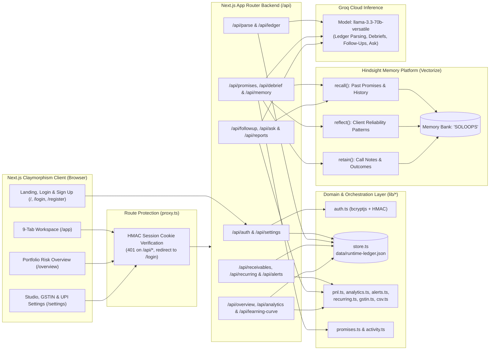
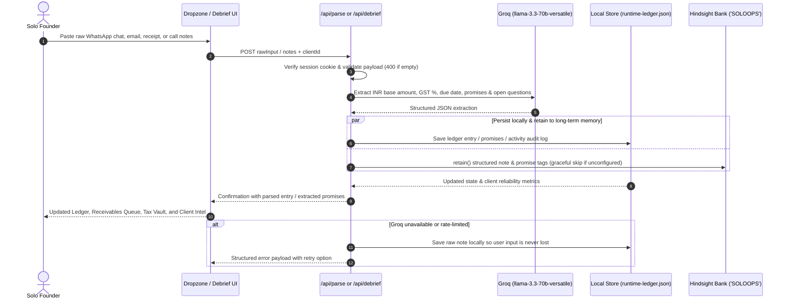
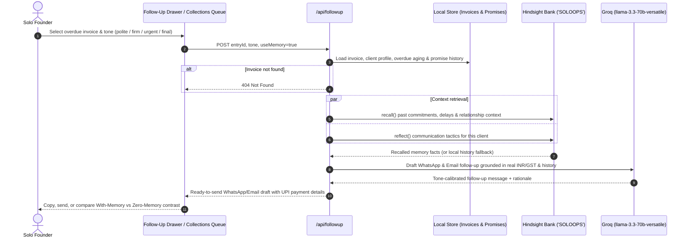

<p align="center">
  
</p>

**🌐 [Live Demo](https://solo-ops-project.onrender.com/)** · [Instant Demo Workspace](https://solo-ops-project.onrender.com/app?demo=true) · [Portfolio Risk Overview](https://solo-ops-project.onrender.com/overview?demo=true)

---

<p align="center">
  
  
  
  
</p>

<h1 align="center">SoloOps: Autonomous One-Person Back Office</h1>

<p align="center">
  
  
  
  
  
  
</p>

---

> An AI-powered financial operations workspace for solo founders, consultants, and freelancers in India. Powered by **Groq** high-speed inference and **Vectorize Hindsight** persistent memory, SoloOps turns messy client chats, emails, and expense receipts into structured INR ledgers, print-ready GST invoices with scannable UPI QR codes, receivable risk forecasts, and tone-calibrated payment follow-ups.

---

## Table of Contents

- [Architecture Overview](#architecture-overview)
- [Core AI & Memory Lifecycles](#core-ai--memory-lifecycles)
- [Authentication & Security Architecture](#authentication--security-architecture)
- [Core Capabilities](#core-capabilities)
- [Setup and Installation](#setup-and-installation)
- [Error Handling Architecture](#error-handling-architecture)
- [Running the Automated Test Suite](#running-the-automated-test-suite)
- [Design System: Claymorphism](#design-system-claymorphism)
- [Deployment](#deployment)
- [Tags](#tags)

---

## Architecture Overview

SoloOps combines three core layers behind a unified Next.js App Router application:

1. **Groq (`groq-sdk`)**: Powers structured command-to-ledger extraction, post-call promise extraction, natural-language "Ask Your Books" Q&A, and tone-calibrated payment follow-up drafts using `llama-3.3-70b-versatile`.
2. **Vectorize Hindsight (`@vectorize-io/hindsight-client`)**: Acts as persistent long-term client memory (`SOLOOPS` bank), retaining call notes, payment promises, and invoice outcomes while supporting `recall()` and `reflect()` queries, with seamless fallback to local history if unconfigured.
3. **Auth, Ledger & Tax Engine (`lib/*`)**: Provides salted `bcryptjs` authentication, HMAC-SHA256 signed `HttpOnly` sessions, route protection (`proxy.ts`), CGST/SGST tax math, GSTIN check-digit validation, recurring schedules, and CA-ready CSV exports.



---

## Core AI & Memory Lifecycles

### 1. Command-to-Ledger & Post-Call Debrief Flow (Retain)



### 2. Grounded Payment Follow-Up & Memory Recall Flow (Recall)



---

## Authentication & Security Architecture

SoloOps protects both pages and API endpoints out of the box:

- **Password Hashing (`lib/auth.ts`)**: All user passwords are salted and hashed with `bcryptjs` (cost = 10) before storage. Plain-text passwords are never saved or returned by any API endpoint.
- **Signed Session Cookies**: Login and registration issue an HMAC-SHA256 signed `HttpOnly` cookie (`soloops_session`, `SameSite=Lax`, 7-day expiry) verified via `crypto.timingSafeEqual`.
- **Route Protection (`proxy.ts`)**: Protected workspaces (`/app`, `/overview`, `/settings`) redirect unauthenticated visitors to `/login`, while protected `/api/*` endpoints return `401 Unauthorized`. Legacy `?demo=true` links safely bootstrap a demo session via `/demo`.
- **Password Visibility UX**: Both `/login` and `/register` include show/hide eye toggles, and `/register` adds confirm-password verification and a live password strength meter.
- **CSV Formula Neutralization (`lib/csv.ts`)**: All exported CSV cells are quoted and sanitized against spreadsheet formula injection (`=`, `+`, `-`, `@`).

---

## Core Capabilities

### Main Landing Page & Brand Identity (`/`)
Features the custom SoloOps geometric ledger logo (`components/Logo.tsx` and `app/icon.svg`), project introduction, 3-step workflow, 6-module showcase, and direct Sign In / Sign Up / Live Demo entry points.

### Command Dropzone & INR Ledger (`/app`)
Converts unstructured client messages and receipts into structured INR invoices and expenses with automatic GST calculation and print-ready invoices featuring scannable UPI QR codes.

### Receivables Aging, Forecast & Smart Collections Queue
- Buckets unpaid invoices by days overdue (Current, 1–30d, 31–60d, 61–90d, 90+d) with accrued late fees.
- Generates a 30 / 60 / 90-day cash-flow forecast weighted by each client's promise-adjusted reliability score.
- Ranks overdue accounts in a Smart Collections Queue with one-click follow-up tone recommendations.

### Client Intel, Promises & Post-Call Debrief
- Tracks payment promises (kept, pending, broken), auto-flagging overdue pending promises.
- Includes a Call Timeline and Memory Inspector (Recall & Reflect) plus Side-by-Side Memory Contrast and Longitudinal Learning Curve views.

### Tax Vault, Recurring Schedules & CA Report Pack
- Computes CGST/SGST output tax and Input Tax Credit (ITC).
- Alerts near GSTR-3B due dates (20th of the month).
- Automates weekly/monthly/quarterly retainers with month-end safety.
- Exports GST Register, Monthly P&L, and Aging CSV packs.

### AI CFO ("Ask Your Books") & Activity Audit Log
Ask natural-language questions grounded strictly in your ledger, review monthly P&L and client concentration charts, and track every change in the Activity Log.

---

## Setup and Installation

### 1. Prerequisites

- **Node.js**: v20.0.0 or higher recommended
- **npm**: v10.x or higher
- **Groq API Key**: Obtainable from [console.groq.com](https://console.groq.com)
- **Hindsight API Key** (optional): Obtainable from [hindsight.vectorize.io](https://hindsight.vectorize.io) (falls back to local memory if omitted)

### 2. Clone and Install Dependencies

```bash
git clone https://github.com/potnuruteja115/Solo-Ops-Project.git
cd Solo-Ops-Project
npm install
```

### 3. Configure Environment Variables

Copy the example environment file:

```bash
cp .env.local.example .env.local
```

Edit `.env.local` with your credentials:

```env
# Groq Cloud API Configuration
GROQ_API_KEY=your_groq_api_key_here
GROQ_MODEL=llama-3.3-70b-versatile

# Vectorize Hindsight API Configuration (Optional - falls back to local memory)
HINDSIGHT_ENDPOINT=https://api.hindsight.vectorize.io
HINDSIGHT_API_KEY=your_hindsight_key_here
HINDSIGHT_BANK_ID=SOLOOPS

# Session Signing Secret
SESSION_SECRET=change-this-secret-in-production-soloops-2026
```

> **Security Note:** `.env.local` is ignored in `.gitignore` and must never be committed to version control.

### 4. Run the Development Server

```bash
npm run dev
```

Open [http://localhost:3000](http://localhost:3000) in your browser:

| Page | URL |
| --- | --- |
| Landing Page | http://localhost:3000 |
| Sign In | http://localhost:3000/login (demo credentials: `demo@soloops.app` / `soloops-demo`) |
| Sign Up | http://localhost:3000/register |
| Instant Demo Workspace | http://localhost:3000/app?demo=true |
| Portfolio Risk Overview | http://localhost:3000/overview?demo=true |

---

## Error Handling Architecture

SoloOps includes retries, graceful degradation, and structured error handling across external dependencies:

| Failure Mode | Detection | Backend Handling | UI Behavior |
| --- | --- | --- | --- |
| Groq rate limit (429) / transient 5xx | Catches 429, 5xx, timeout, or `ECONNRESET` | Exponential backoff with jitter (up to 3 retries) in `lib/groq.ts` | Clear terracotta alert banner with retry option; raw input preserved |
| Missing `GROQ_API_KEY` | Checked via `/api/status` and `getGroqClient()` | Returns structured error without leaking secrets | TopNav badge switches to "Groq key missing"; core ledger and tax features stay usable |
| Hindsight unconfigured / timeout | `isHindsightConfigured()` / try-catch in `lib/hindsight.ts` | Gracefully falls back to local history and promise store | TopNav displays "Local memory"; debriefs and follow-ups keep working without crashing |
| Unauthenticated request | Verified in `proxy.ts` | Returns 401 for `/api/*` and redirects protected pages to `/login` | Seamless redirect to Login or `/demo` bootstrap for `?demo=true` links |
| Invalid settings (GSTIN / UPI) | Format + GSTIN check-digit validator (`lib/gstin.ts`) | Returns 400 with field-level validation error | Inline validation feedback before persisting settings |

---

## Running the Automated Test Suite

### 1. API & Security Integration Tests (Node Native Test Runner)

Start the dev server (`npm run dev`), then run:

```bash
npm test
```

**Test coverage (35+ assertions):**

- **Auth & Route Protection**: Unauthenticated `/api/*` returns 401; protected pages redirect to `/login`; wrong demo password rejected; `/demo` ignores unsafe redirect targets; `/api/settings` strips `passwordHash`.
- **Receivables & Aging**: 5 aging buckets, time-shift bucket transitions, accrued late fees, invalid `asOf` handling, and promise-adjusted cash-flow forecasts.
- **Promises, Debriefs & Memory**: Auto-broken overdue promises, CRUD lifecycle, local note retention even if AI extraction is unavailable, and local memory fallback.
- **Recurring, Analytics, Alerts & Reports**: Month-end idempotent invoice generation, GSTR-3B 20th-of-month alerts, GST/P&L/Aging CSV attachments, and CSV formula neutralization.

### 2. End-to-End Browser Smoke Test (Playwright)

Requires Playwright for Python:

```bash
pip install playwright && playwright install chromium
python3 tests/ui_smoke.py
```

Verifies that all 9 workspace tabs render without console/page errors, URL tab synchronization, Recharts SVG rendering, recurring schedule creation, and activity logging.

---

## Design System: Claymorphism

SoloOps uses a restrained, warm Claymorphism visual language:

- **Palette**: Warm sand background (`#e6dfd3`), molded clay surfaces (`#eee8dc`), inset panels (`#e8e2d5`), terracotta primary accent (`#b8623f`), muted sage secondary accent (`#7d9080`), and warm charcoal text (`#2a2622`).
- **Surfaces**: 16px–24px border radii with dual-directional soft elevation shadows and subtle top-left inner highlights.
- **Typography**: Source Serif 4 for headings, Source Sans 3 for UI body copy, and JetBrains Mono for INR figures, GSTINs, UPI IDs, and keyboard shortcuts (`Ctrl+K`, `Alt+1`–`Alt+9`).
- **Print Support**: Dedicated `@media print` styles render clean white-background GST tax invoices with scannable UPI QR codes.

---

## Deployment

### Render (Recommended)

1. Create a new **Web Service** on [dashboard.render.com](https://dashboard.render.com) connected to `potnuruteja115/Solo-Ops-Project`.
2. Set **Build Command** to `npm install && npm run build` and **Start Command** to `npm start`.
3. Add `SESSION_SECRET`, `GROQ_API_KEY`, and (optionally) `HINDSIGHT_API_KEY` in Environment Variables.
4. Click **Deploy Web Service**.

---

## Tags

`#SoloOps` `#ACEBuilders` `#GigPoint` `#Codebenders` `#Hackathon` `#NextJS` `#TypeScript` `#React19` `#TailwindCSS` `#Groq` `#VectorizeHindsight` `#AIAgent` `#FinTech` `#SaaS` `#Freelancing` `#SoloFounder` `#GST` `#UPI` `#Claymorphism` `#OpenSource`
