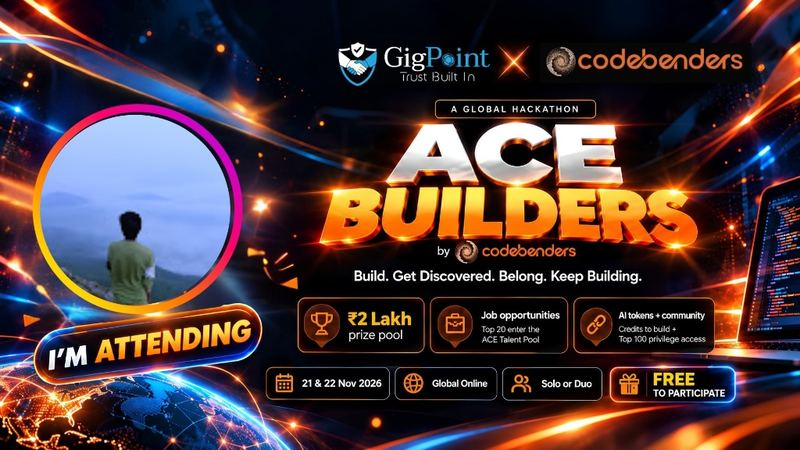

<p align="center">
  
</p>

---

<p align="center">
  
  
  
  
</p>

<h1 align="center">SoloOps: Autonomous One-Person Back Office</h1>

<p align="center">
  
  
  
  
  
  
</p>

---

## Table of Contents

- [Architecture Overview](#architecture-overview)
- [Core AI & Memory Lifecycles](#core-ai--memory-lifecycles)
- [Authentication & Security Architecture](#authentication--security-architecture)
- [Core Capabilities](#core-capabilities)
- [Setup and Installation](#setup-and-installation)
- [Error Handling Architecture](#error-handling-architecture)
- [Running the Automated Test Suite](#running-the-automated-test-suite)
- [Design System: Claymorphism](#design-system-claymorphism)
- [Deployment](#deployment)
- [Tags](#tags)

---

# SoloOps: Autonomous One-Person Back Office

> An AI-powered financial operations workspace for solo founders, consultants, and freelancers in India. Powered by **Groq** high-speed inference and **Vectorize Hindsight** persistent memory, SoloOps turns messy client chats, emails, and expense receipts into structured INR ledgers, print-ready GST invoices with scannable UPI QR codes, receivable risk forecasts, and tone-calibrated payment follow-ups.

---

## Architecture Overview

SoloOps combines three core layers behind a unified Next.js App Router application:
1. **Groq (`groq-sdk`)**: Powers structured command-to-ledger extraction, post-call promise extraction, natural-language "Ask Your Books" Q&A, and tone-calibrated payment follow-up drafts using `llama-3.3-70b-versatile`.
2. **Vectorize Hindsight (`@vectorize-io/hindsight-client`)**: Acts as persistent long-term client memory (`SOLOOPS` bank), retaining call notes, payment promises, and invoice outcomes while supporting `recall()` and `reflect()` queries—with seamless fallback to local history if unconfigured.
3. **Auth, Ledger & Tax Engine (`lib/*`)**: Provides salted `bcryptjs` authentication, HMAC-SHA256 signed `HttpOnly` sessions, route protection (`proxy.ts`), CGST/SGST tax math, GSTIN check-digit validation, recurring schedules, and CA-ready CSV exports.

```mermaid
flowchart LR
    subgraph Client["Next.js Claymorphism Client (Browser)"]
        direction TB
        UI_Landing["Landing, Login & Sign Up (/, /login, /register)"]
        UI_App["9-Tab Workspace (/app)"]
        UI_Overview["Portfolio Risk Overview (/overview)"]
        UI_Settings["Studio, GSTIN & UPI Settings (/settings)"]
    end

    subgraph Security["Route Protection (proxy.ts)"]
        Auth_Guard["HMAC Session Cookie Verification<br/>(401 on /api/*, redirect to /login)"]
    end

    subgraph API["Next.js App Router Backend (/api)"]
        direction TB
        Route_Auth["/api/auth & /api/settings"]
        Route_Parse["/api/parse & /api/ledger"]
        Route_Receivables["/api/receivables, /api/recurring & /api/alerts"]
        Route_Intel["/api/promises, /api/debrief & /api/memory"]
        Route_Followup["/api/followup, /api/ask & /api/reports"]
        Route_Overview["/api/overview, /api/analytics & /api/learning-curve"]
    end

    subgraph Services["Domain & Orchestration Layer (lib/*)"]
        direction TB
        Lib_Auth["auth.ts (bcryptjs + HMAC)"]
        Lib_Store[("store.ts<br/>data/runtime-ledger.json")]
        Lib_Finance["pnl.ts, analytics.ts, alerts.ts,<br/>recurring.ts, gstin.ts, csv.ts"]
        Lib_Promises["promises.ts & activity.ts"]
    end

    subgraph Hindsight["Hindsight Memory Platform (Vectorize)"]
        direction TB
        HS_Recall["recall(): Past Promises & History"]
        HS_Reflect["reflect(): Client Reliability Patterns"]
        HS_Retain["retain(): Call Notes & Outcomes"]
        HS_Bank[("Memory Bank: 'SOLOOPS'")]
    end

    subgraph Groq["Groq Cloud Inference"]
        Groq_LLM["Model: llama-3.3-70b-versatile<br/>(Ledger Parsing, Debriefs, Follow-Ups, Ask)"]
    end

    UI_Landing --> Route_Auth
    UI_App --> Auth_Guard
    UI_Overview --> Auth_Guard
    UI_Settings --> Auth_Guard
    Auth_Guard --> API

    Route_Auth --> Lib_Auth
    Route_Auth --> Lib_Store
    Route_Parse --> Groq_LLM
    Route_Parse --> Lib_Store
    Route_Receivables --> Lib_Finance
    Route_Receivables --> Lib_Store
    Route_Intel --> Lib_Promises
    Route_Intel --> HS_Retain
    Route_Intel --> HS_Recall
    Route_Intel --> HS_Reflect
    Route_Intel --> Groq_LLM
    Route_Followup --> HS_Recall
    Route_Followup --> Groq_LLM
    Route_Followup --> Lib_Finance
    Route_Overview --> Lib_Finance
    Route_Overview --> Lib_Store

    HS_Recall --> HS_Bank
    HS_Reflect --> HS_Bank
    HS_Retain --> HS_Bank
